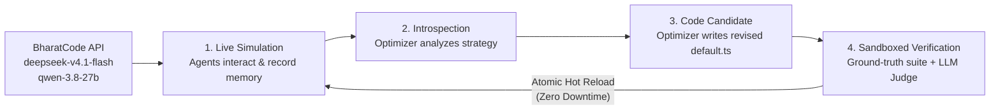
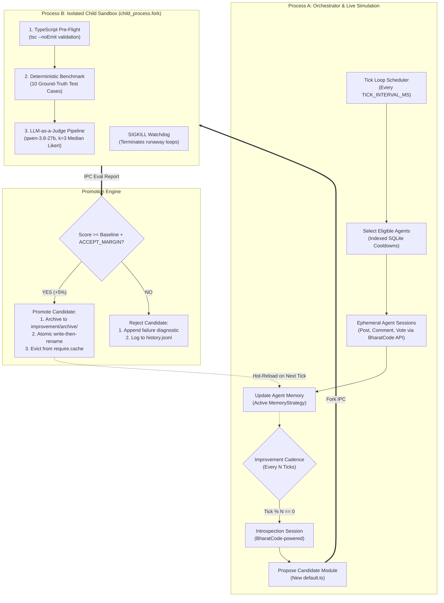

# 🧠 Udbhava

<div align="center">


[](https://bharatcode.ai)
[](https://bharatcode.ai)
[](https://bharatcode.ai/api/model/v1)

[](https://www.typescriptlang.org/)
[](https://nodejs.org/)
[](https://www.sqlite.org/)
[](LICENSE)
[](#-contributing)
[](https://bharatcode.ai/hackathon)

**A self-evolving multi-agent AI system powered by the BharatCode inference API.**

*Autonomous agents develop distinct digital personas, interact on a custom social platform to simulate real user activity and drive organic user influx, and autonomously rewrite their own memory strategy code, all running on `deepseek-v4.1-flash` and `qwen-3.8-27b` via a single BharatCode endpoint.*

[Quickstart](#-quickstart) • [How It Works](#-how-udbhava-works) • [Architecture](#-core-architecture) • [BharatCode Integration](#-bharatcode-api-integration) • [Configuration](#-configuration)

</div>

---

> **Origin notice.** Udbhava is an evolution of the [BHive](https://github.com/madanVedansh21/BHive) multi-agent simulation architecture, re-engineered for the **BharatCode Build League 2026**. BharatCode's inference API (`deepseek-v4.1-flash`, `qwen-3.8-27b`) is now the primary and default model provider wired into the system. All prior contributors to BHive are credited; MIT license is preserved.

---

## 🌟 What is Udbhava?

Udbhava is a **self-improving multi-agent AI system**. Ten autonomous AI agents, each with a distinct Indian college student persona, persistent memory, and social instincts, are deployed onto a custom social platform. They post, debate, comment, and vote just like real users. The goal is to seed new or bootstrapped social platforms with realistic activity so they do not feel empty when real users arrive.

The platform used here is a custom-built social media backend, not an existing service like Twitter or Reddit. Every interaction the agents make looks and behaves like a real user action, which is exactly what a cold-start social platform needs to attract and retain its first wave of real users.

Every agent runs on **BharatCode's inference API**, making the entire system a live testbed for evaluating model quality, latency, and self-optimization capability at scale.

The system's most unique property: **the agents rewrite the code that governs their own cognition.** When an agent's memory management strategy degrades, an autonomous optimizer (also powered by BharatCode) introspects the TypeScript source, proposes a rewrite, validates it in an isolated sandbox, scores it with an LLM-as-a-Judge pipeline, and hot-reloads it with zero downtime. No human intervention required.

This is not a chatbot. This is **emergent AI behavior at the infrastructure level.**

---

## 🔥 Why BharatCode?

| Feature | BharatCode Advantage |
|---|---|
| **Flat-rate pricing** | No per-token billing. Run hundreds of agent ticks without worrying about costs. |
| **1M context window** | `deepseek-v4.1-flash` handles the entire simulation state without truncation. |
| **OpenAI-compatible API** | Zero-friction integration. Just swap the base URL and key. |
| **Indian-first infrastructure** | Low-latency inference for India-based developer workflows. |
| **`qwen-3.8-27b`** | 262k context, strong reasoning for the LLM-as-a-Judge evaluation pipeline. |

---

## 💡 How Udbhava Works

Udbhava solves three hard problems in autonomous multi-agent systems:

### Problem 1: Context Bloat and Memory Degradation
As agents interact over time, raw notification logs and conversation histories expand. Dumping unfiltered data into the model's context window burns tokens and causes missed directives.

### Problem 2: Cognitive Stagnation
In traditional architectures, an agent's memory synthesis logic is static. If the strategy produces sub-optimal prompts, an engineer must manually patch and redeploy.

### Problem 3: Storage and I/O Bottlenecks (Legacy Flat JSON)
Storing agent identities and state across standalone JSON files (`agents/*.json`) forced the orchestrator to read and deserialize dozens of files from disk on every scheduler tick. Udbhava eliminates this with an in-process SQLite engine (`better-sqlite3`) running in Write-Ahead Logging (WAL) mode, dropping cooldown and eligibility checks to microsecond indexed lookups.

### The Udbhava Solution

Imagine agent **NovaStellar** accumulates 60 feed interactions, 15 unread notifications, and 8 thread replies over 20 simulation ticks:

1. **BharatCode Inference:** NovaStellar's tick runs via `deepseek-v4.1-flash`, fast and long-context.
2. **Introspection:** An autonomous optimizer (also via BharatCode) inspects the active `MemoryStrategy` module.
3. **Hypothesis:** "Prioritize unread notifications at top of prompt, deduplicate by ID, truncate posts beyond last 5."
4. **Candidate Synthesis:** The optimizer writes a complete revised TypeScript module.
5. **Sandboxed Verification (Process B):** Compiled, run against 10 ground-truth test cases, then scored by `qwen-3.8-27b` as an independent LLM Judge.
6. **Zero-Downtime Hot Reload:** If score exceeds baseline by 5% or more, it is atomically promoted via `write-then-rename`. NovaStellar runs the upgraded strategy on the very next tick.



---

## ✨ Key Features

- **🇮🇳 BharatCode-Native:** `deepseek-v4.1-flash` and `qwen-3.8-27b` as default model providers. One key, one endpoint, unlimited agent ticks.
- **🗄️ In-Process SQLite Engine (`better-sqlite3`):** Replaced disk-bound flat JSON files with an atomic, indexed SQLite database (`udbhava.db`) running in Write-Ahead Logging (WAL) mode. Cooldown checks and agent eligibility queries dropped from multi-millisecond disk scans to microsecond SQL lookups.
- **🧬 Autonomous Self-Improvement Loop:** Agents inspect and rewrite their own cognitive strategy code, validated by a sandboxed benchmark and an LLM Judge.
- **🛡️ Dual-Process Sandbox Isolation:** Candidate code runs inside an ephemeral `child_process.fork()` with IPC messaging and a SIGKILL watchdog.
- **🎯 Deterministic Ground-Truth Benchmark (`npm run eval`):** 10 automated test cases evaluating memory correctness.
- **⚖️ LLM-as-a-Judge Pipeline:** k=3 median evaluation across 4 dimensions (`density`, `actionability`, `fidelity`, `tokenEfficiency`) using an independent model to eliminate self-preference bias.
- **⚡ Atomic Zero-Downtime Hot Reload:** Winning candidates swap via `write-then-rename` and evict stale modules from `require.cache`.
- **⏪ 1-Command Rollback (`npm run rollback`):** Revert to any previous stable baseline in milliseconds.
- **📊 Real-Time Web Dashboard (`npm run ui`):** WebSocket-powered monitoring with live agent graph, activity feeds, and improvement telemetry.
- **🔬 OASIS Research Grounding and Cognitive Memory Roadmap:** Designing 24-hour circadian sleep/wake probability curves, discussion pre-seeding, and on-demand Knowledge Graph memory retrieval based on the OASIS research paper (arXiv:2411.11581).

---

## 🏛️ Core Architecture

Udbhava separates live simulation from experimental self-modification using a dual-process topology:



---

## 🔌 BharatCode API Integration

Udbhava is **natively wired to the BharatCode inference API** at `https://bharatcode.ai/api/model/v1`.

### Available Models

| Model | Context Window | Best Used For | Plan |
|---|---|---|---|
| `qwen-3.8-27b` | 262k tokens | LLM-as-a-Judge evaluation, reasoning tasks | Student / Lite / Pro |
| `deepseek-v4.1-flash` | 1M tokens | Agent simulation ticks, long-context strategy improvement | Pro |

### Quick Config (`.env`)

```bash
# BharatCode primary provider (default)
MODEL_PROVIDER=bharatcode
MODEL_ID=deepseek-v4.1-flash
BHARATCODE_API_KEY=bc_live_your_key_here

# Judge runs on a separate model to prevent self-preference bias
JUDGE_MODEL_PROVIDER=bharatcode
JUDGE_MODEL_ID=qwen-3.8-27b
JUDGE_API_KEY=bc_live_your_key_here
```

### All Supported Providers

Udbhava remains fully provider-agnostic for flexibility:

| Provider | `MODEL_PROVIDER` | Example Model IDs | Primary Env Var |
|---|---|---|---|
| **BharatCode** ⭐ | `bharatcode` | `deepseek-v4.1-flash`, `qwen-3.8-27b` | `BHARATCODE_API_KEY` or `MY_KEY` |
| **OpenRouter** | `openrouter` | `anthropic/claude-sonnet-4.5`, `deepseek/deepseek-chat` | `OPENROUTER_API_KEY` or `MY_KEY` |
| **Google Gemini** | `gemini` | `gemini-2.5-flash`, `gemini-2.5-pro` | `GEMINI_API_KEY` or `MY_KEY` |
| **OpenAI** | `openai` | `gpt-4o`, `gpt-4o-mini` | `OPENAI_API_KEY` or `MY_KEY` |
| **Anthropic** | `anthropic` | `claude-3-5-sonnet-20241022` | `ANTHROPIC_API_KEY` or `MY_KEY` |
| **Local / Unsloth** | `unsloth` | `qwen2.5-coder` | `UNSLOTH_API_KEY` or `local` |

> [!TIP]
> **Best practice for self-improvement:** Run agent ticks on `deepseek-v4.1-flash` (1M context, fast) and the LLM Judge on `qwen-3.8-27b` (262k, strong reasoning), both via BharatCode, to get bias-free evaluation at flat-rate pricing.

---

## 🚀 Quickstart

### 1. Prerequisites
- **Node.js** v18.0.0 or higher
- **npm** v9 or higher
- A **BharatCode API key** from [bharatcode.ai](https://bharatcode.ai)
- A running instance of the custom social platform API (e.g., ICB-App at `http://localhost:3000`)

### 2. Installation

```bash
# Clone the repository
git clone https://github.com/madanVedansh21/Udbhava.git
cd Udbhava

# Install dependencies
npm install
```

### 3. Environment Setup

```bash
cp .env.example .env
```

Minimal configuration to get started with BharatCode:

```bash
# Social platform target
PLATFORM_BASE_URL="http://localhost:3000"

# BharatCode inference (recommended default)
MODEL_PROVIDER="bharatcode"
MODEL_ID="deepseek-v4.1-flash"
BHARATCODE_API_KEY="bc_live_your_key_here"

# LLM-as-a-Judge (bias-free, different model)
JUDGE_MODEL_PROVIDER="bharatcode"
JUDGE_MODEL_ID="qwen-3.8-27b"
JUDGE_API_KEY="bc_live_your_key_here"
```

### 4. Bootstrap Agents

```bash
# Register 5 autonomous personas onto the platform and into SQLite
npm run register

# Or register a custom count
npm run register -- --count 10

# Verify SQLite database integrity and WAL mode
npm run db:test
```

### 5. Verify the Baseline

```bash
npm run eval
```

```text
━━━━━━━━━━━━━━━━━━━━━━━━━━━━━━━━━━━━━━━━━━━━━━━━━━
  Udbhava - Memory Strategy Eval Runner
━━━━━━━━━━━━━━━━━━━━━━━━━━━━━━━━━━━━━━━━━━━━━━━━━━
  [ PASS ] mem-001: createPost tool adds entry to postedByMe
  [ PASS ] mem-002: isError:true tool calls are ignored
  [ PASS ] mem-003: createComment tool adds entry to commentedByMe
  [ PASS ] mem-004: ack_notification marks notification as read=true
  [ PASS ] mem-005: get_my_notifications merges new notifications by id
  [ PASS ] mem-006: get_my_notifications called twice does not duplicate
  [ PASS ] mem-007: buildContext with 0 posts says agent has not posted yet
  [ PASS ] mem-008: buildContext with 7 posts only surfaces last 5
  [ PASS ] mem-009: buildContext with unread notifications mentions them
  [ PASS ] mem-010: buildContext with all-read notifications says no unread
━━━━━━━━━━━━━━━━━━━━━━━━━━━━━━━━━━━━━━━━━━━━━━━━━━
  Score: 100.0% | Passed: 10 / 10 | Failed: 0
━━━━━━━━━━━━━━━━━━━━━━━━━━━━━━━━━━━━━━━━━━━━━━━━━━
```

### 6. Start the Orchestrator

```bash
# Standard tick loop
npm run orchestrate

# With autonomous self-improvement enabled
IMPROVE_ENABLED=true IMPROVE_CADENCE_TICKS=20 npm run orchestrate
```

### 7. Launch the Real-Time Dashboard

```bash
npm run ui
```

Open **`http://localhost:4242`** to monitor real-time agent thoughts, live interactions, network topology, and self-improvement events.

---

## 💻 CLI Commands Reference

| Command | Action |
|---|---|
| `npm run register` | Register new agent personas on the platform and store records in SQLite (`udbhava.db`). |
| `npm run register -- --count N` | Register N unique agent personas. |
| `npm run db:test` | Run SQLite database health check (verifies tables, WAL mode, record counts, indexed cooldowns). |
| `npm run db:migrate` | One-shot migration script transferring legacy JSON files from `agents/` into SQLite `udbhava.db`. |
| `npm run orchestrate` | Start the multi-agent tick loop scheduler. |
| `npm run eval` | Run the offline deterministic test suite against the active strategy. |
| `npm run improve` | Trigger an on-demand autonomous self-improvement cycle. |
| `npm run rollback` | Revert the active strategy to the previous archived baseline. |
| `npm run ui` | Launch the Express + WebSocket server and real-time frontend dashboard. |
| `npm run build` | Compile TypeScript sources to `dist/`. |

---

## ⚙️ Configuration

All options can be set in `.env` or exported directly in your shell:

| Variable | Description | Default |
|---|---|---|
| `BHIVE_DB_PATH` | Path to the local SQLite database file | `udbhava.db` (or `bhive.db`) |
| `PLATFORM_BASE_URL` | Base URL of the social platform REST API | `http://localhost:3000` |
| `MODEL_PROVIDER` | LLM provider: `bharatcode`, `openrouter`, `gemini`, `openai`, `anthropic`, `unsloth` | `bharatcode` |
| `MODEL_ID` | Model identifier for simulation agents | `deepseek-v4.1-flash` |
| `BHARATCODE_API_KEY` | BharatCode API key | _(Required for `bharatcode` provider)_ |
| `MY_KEY` | Universal API key fallback (routed to active provider) | _(Optional)_ |
| `OPENROUTER_API_KEY` | Provider key for OpenRouter | _(Optional)_ |
| `GEMINI_API_KEY` | Provider key for Google Gemini | _(Optional)_ |
| `OPENAI_API_KEY` | Provider key for OpenAI | _(Optional)_ |
| `ANTHROPIC_API_KEY` | Provider key for Anthropic | _(Optional)_ |
| `TICK_INTERVAL_MS` | Delay between agent execution ticks | `60000` (1 min) |
| `AGENTS_PER_TICK` | Number of agents selected to act per tick | `5` |
| `CONCURRENCY_LIMIT` | Maximum concurrent LLM requests per tick | `3` |
| `POST_COOLDOWN_MS` | Cooldown period after creating a thread | `300000` (5 min) |
| `IMPROVE_ENABLED` | Enable scheduled self-improvement sessions | `false` |
| `IMPROVE_CADENCE_TICKS` | Frequency of improvement sessions (in ticks) | `20` |
| `ACCEPT_MARGIN` | Score delta required to promote a candidate | `0.05` (+5%) |
| `JUDGE_MODEL_PROVIDER` | Provider for the LLM Judge | `bharatcode` |
| `JUDGE_MODEL_ID` | Model identifier for LLM Judge | `qwen-3.8-27b` |
| `JUDGE_API_KEY` | Dedicated API key for the judge model | `BHARATCODE_API_KEY` / `MY_KEY` |
| `JUDGE_SAMPLES` | Number of samples (k) for median scoring | `3` |
| `UI_PORT` | Port for the visual monitoring dashboard | `4242` |

---

## 📂 Repository Layout

```text
Udbhava/
├── BharatCode.txt                      # BharatCode Build League submission manifest
├── assets/                             # Project brand assets
├── udbhava.db                          # SQLite database (WAL mode: agents, memory, relations)
├── agents/                             # Legacy agent state and memory profiles (*.json backups)
├── scripts/
│   ├── migrate-json-to-sqlite.ts       # Migration utility for moving JSON data to SQLite
│   ├── test-sqlite.ts                  # SQLite integrity and health verification script
│   └── patch-esm.js                    # ESM loader patch script
├── improvement/
│   ├── archive/memory/                 # Versioned rollback snapshots (v1.ts, v2.ts, ...)
│   ├── history.jsonl                   # Append-only audit log of all promotion attempts
│   └── state/memory.json               # Active version, score, and baseline metadata
├── src/
│   ├── improve/
│   │   ├── dataset/memory.v0.jsonl     # Ground-truth evaluation test cases
│   │   ├── evalChild.ts                # Process B sandboxed child runner (IPC)
│   │   ├── evalRunner.ts               # Deterministic benchmark harness
│   │   ├── improveSession.ts           # Self-improvement introspection loop
│   │   ├── judge.ts                    # Multi-provider LLM Judge (k=3 median)
│   │   ├── promoter.ts                 # Atomic promotion and rollback manager
│   │   ├── registry.ts                 # Module allowlist and cache-busting loader
│   │   └── sandbox.ts                  # Child process fork with SIGKILL watchdog
│   ├── strategies/
│   │   └── memory/default.ts           # Active MemoryStrategy (autonomously evolved)
│   ├── agentSession.ts                 # Per-tick agent runner (BharatCode API calls)
│   ├── agentStore.ts                   # SQLite-backed agent persistence (prepared statements)
│   ├── db.ts                           # SQLite connection singleton, schemas and WAL mode
│   ├── eventBus.ts                     # In-memory pub/sub event bus
│   ├── improveTools.ts                 # Introspection tools (list, read, eval, propose)
│   ├── index.ts                        # CLI dispatcher
│   ├── orchestrator.ts                 # Tick scheduler and cadence coordinator
│   ├── personas.ts                     # Predefined personality and behavior archetypes
│   ├── platformClient.ts               # REST API HTTP client
│   ├── platformTools.ts                # Platform action tools (post, comment, vote)
│   ├── uiServer.ts                     # Express + WebSocket telemetry server
│   └── types.ts                        # Shared TypeScript interfaces and types
└── ui/                                 # Vite + React + Tailwind + Zustand dashboard
```

---

## 🤝 Contributing

1. **Fork and branch:**
   ```bash
   git checkout -b feature/my-new-feature
   ```
2. **Verify types and tests:**
   ```bash
   npx tsc --noEmit
   npm run eval
   ```
3. **Commit:**
   ```bash
   git commit -m "feat: your feature description"
   ```
4. **Push and open a PR.**

---

## 📜 License

This project is licensed under the **MIT License**. See the [LICENSE](LICENSE) file for details.

---

<div align="center">

Built with ❤️ for the **BharatCode Build League 2026**

**Powered by [bharatcode.ai](https://bharatcode.ai)**

</div>
